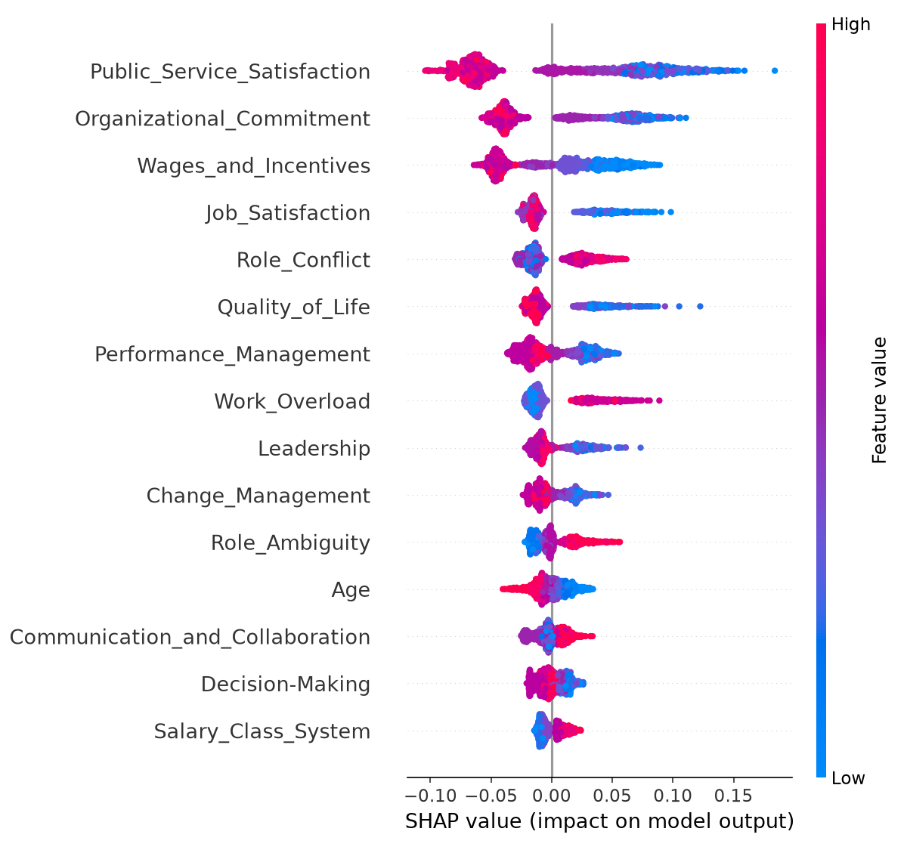
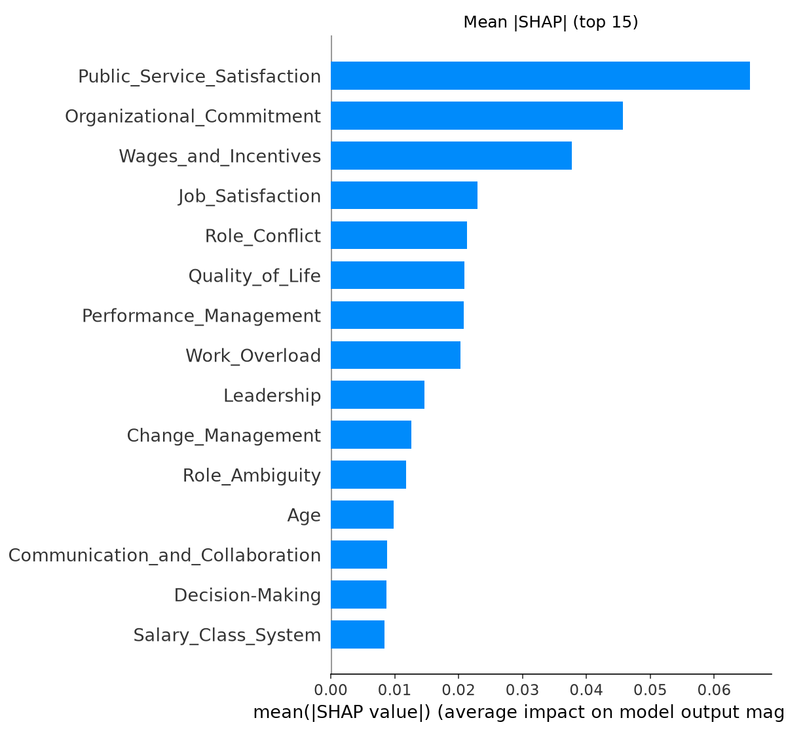
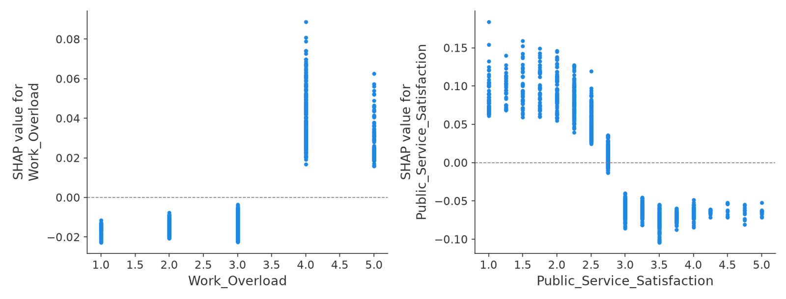

# SHAP으로 본 MZ세대 공무원 이직의도의 심리적 메커니즘

랜덤 포레스트로 MZ세대 공무원의 이직의도를 예측하고 SHAP으로 해석한 분석 코드

## 개요

- 예측모형만으로는 어떤 변수가 어떤 방향으로 이직의도를 높이는지 드러나지 않는 한계
- SHAP으로 변수별 기여의 크기, 방향, 형태와 변수 간 상호작용 해석

## 방법 설명

- **랜덤 포레스트**: 자료와 변수를 무작위로 뽑아 만든 의사결정나무 여러 개의 예측을 모아 판단하는 머신러닝 모형
- **SHAP**: 예측값에 각 변수가 얼마나, 어느 방향으로 기여했는지를 사례별로 나눠 보여 주는 설명 방법

## 자료

- 2023 공직생활실태조사(한국행정연구원) 중 MZ세대 공무원 4,288명
- 예측변수 55개(척도 평균과 인구통계), 결과변수는 이직의도(있음/없음)
- 원자료는 비공개
- 분석 자료 `data_cleaned.csv`는 [ml-practice](https://github.com/wls0kim/ml-practice)의 `turnover-logistic-ml/01_logistic_regression.Rmd`에서 생성

## 분석 절차

1. PyCaret으로 여러 분류 모형 비교 (10겹 층화 교차검증, AUC 기준)
2. 학습 70%, 시험 30% 분할
3. 랜덤 포레스트 하이퍼파라미터를 학습 자료 10겹 교차검증으로 선택(트리 800개, 분기 후보 변수 6개, 최소 잎 크기 5), 시험 자료 성능 확인
4. 불순도 기반 변수 중요도와 SHAP(평균 |SHAP|, 요약 그림, 의존성 그림)으로 해석

## 주요 결과

- 시험 자료 성능: 정확도 .722, AUC .802
- SHAP 상위 10개 변수가 전체 기여의 63.1% 설명
- 기여가 큰 변수: 공직만족, 조직몰입, 보수 및 보상, 직무만족, 역할 갈등, 삶의 질, 성과관리, 업무 과부하
- 공직만족, 조직몰입, 보수 및 보상, 직무만족, 삶의 질이 높을수록 이직의도 감소
- 역할 갈등, 업무 과부하, 역할 모호성이 높을수록 이직의도 증가, 연령이 낮을수록 이직의도 증가
- 비선형 관계: 만족 관련 변수는 보통(3점)을 넘으면 효과가 더 커지지 않고, 업무 과부하와 역할 갈등은 보통 이하에서는 차이가 거의 없다가 보통을 넘으면 이직의도가 급격히 증가

**SHAP 요약 그림** (점 하나가 시험 자료 응답자 한 명, 색은 변수 값의 높낮이)

**평균 |SHAP| 상위 15개 변수**

**의존성 그림: 업무 과부하, 공직만족**

- 그림: `rf_shap_2025.ipynb` 실행 결과 (시험 자료 1,287명)

## 코드

| 파일 | 내용 |
|---|---|
| `rf_shap_2025.ipynb` | 모형 비교부터 SHAP 해석까지 (출력 결과는 제외) |

## 성과

- 김진영, 이태헌 (2025.04). SHAP 기반 설명 가능한 AI로 들여다본 공무원 이직의도의 심리적 메커니즘. 한국심리측정평가학회 춘계학술대회 구두 발표.

## 참여

- 김진영, 이태헌
